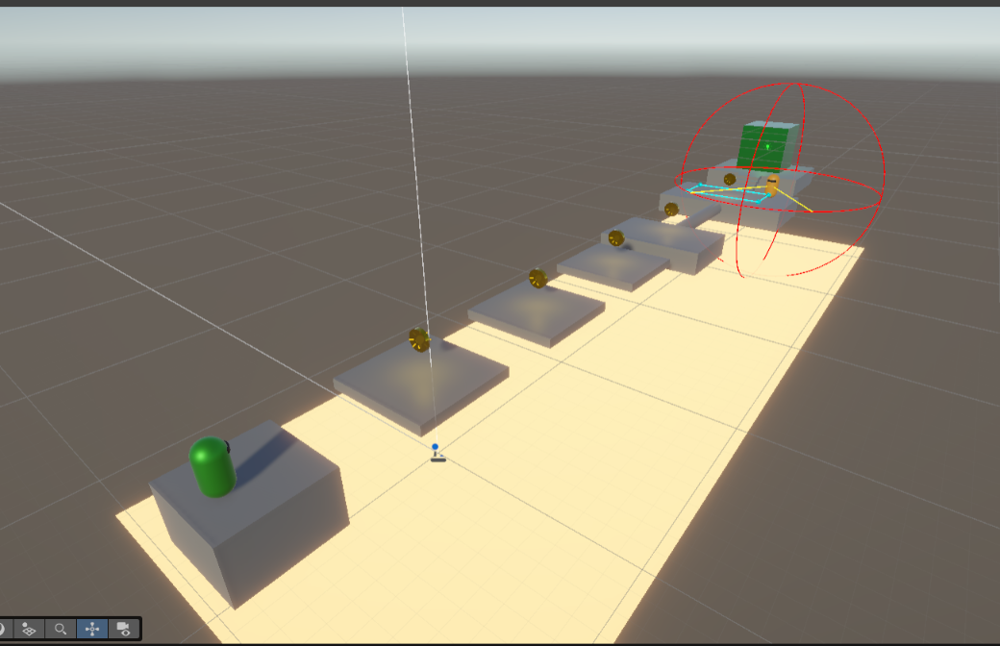
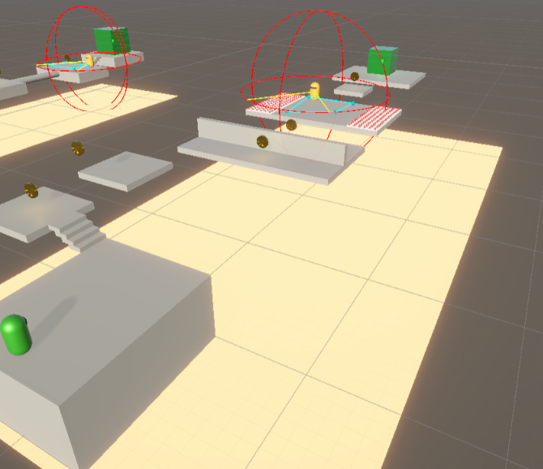
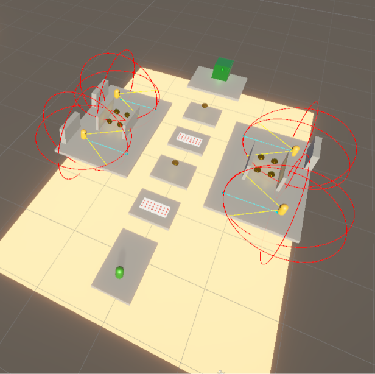
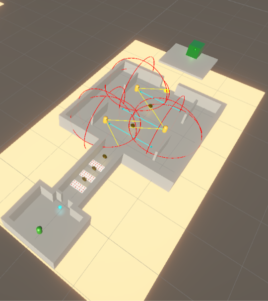
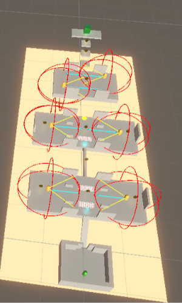

# CS464 Assignment 03 - Mustafa Fawwaz - BSSE23036

- **Video Link:** https://drive.google.com/file/d/1wccR-28FIr86tzeoPV45t4xS57vvGoUB/view?usp=sharing
- **Started from:** https://github.com/bsse23036/ITU-CS-464-ASSIGNMENT-02-BSSE23036.git
- **Controls:** WASD for camera-relative movement, Mouse to orbit camera, Spacebar for variable jump (with Coyote Time and Jump Buffering), Esc to toggle cursor lock
- **To win a level:** Reach the green `GoalZone` portal before the timer expires

## Levels

| Level | Screenshot | New idea | Combined with | 
| ----- | ----- | ----- | ----- | 
| Level01 |  | Introduction to camera-relative WASD platforming, coin collection, and basic guard line-of-sight detection. | Stepping platform elevation leading directly to the exit portal. | 
| Level02 |  | Vertical stair ascensions with dynamic timed spike hazard arrays ($\ge 0.5\text{s}$ warning). | Guard patrol loops guarding mid-level platform coin clusters. | 
| Level03 |  | Diverging 3-lane route: Central high-risk spike bridge vs. Left/Right stealth cover arenas. | Solid wall occlusion breaking multiple guard vision cones (`obstacleMask`). | 
| Level04 |  | Power-Up spawn room, tight spatial pinch hazard corridor, and high-density multi-guard courtyard. | Timed Shield/Invincibility buff combined with aggressive guard chase mechanics ($5.5\text{m/s}$). | 
| Level05 |  | Multi-stage ascending arenas with jump pads, overlapping guard vision networks, and hazard fields. | Level-wide bottom `KillZone`, strict countdown timer, and full integration of all mechanics. | 

## The numbers

| Number | Value | Why this value |
|---|---|---|
| Patrol speed | `3.5 m/s` | Slower than the player's movement speed (`5.5 m/s`), establishing a predictable rhythm for players to observe and plan stealth routes. |
| Chase range | `10.0 m` | Broad enough to detect players crossing open platforms, but restricted by field-of-view ($70^\circ$) and obstacle line-of-sight raycasting. |
| Knockback | `10.0` (`ForceMode.Impulse`) | Applies an instant velocity impulse that pushes the player clear of hazards by approximately $2.5\text{m}$ without launching them out of bounds. |
| I-frames | `1.0 s` | Provides enough time for the player to recover and move away from multi-hit hazards or enemies without stacking damage repeatedly. |
| Power-up duration | `5.0 s` | Long enough to clear a tight spatial pinch or hazard corridor, but not long enough to trivialize an entire level without precise timing. |

## Short answers

**1. Why does a trigger need a Rigidbody on at least one of the two objects?**
Unity's physics engine optimizes collision testing by ignoring static-to-static overlaps. For Unity to trigger `OnTriggerEnter`, `OnTriggerStay`, or `OnTriggerExit` callbacks, at least one of the participating GameObjects must have an active `Rigidbody` component (kinematic or dynamic) so the broadphase collision system registers moving trigger events.

**2. Which ForceMode do your knockback and your Part A force use, and why each?**
* **Part A Force (JumpPad / Launch Pad):** Uses `ForceMode.Impulse`. It applies an instantaneous mass-dependent force ideal for launching the player upward or across gaps in a single frame without waiting for continuous acceleration over time.
* **Knockback:** Uses `ForceMode.Impulse` after explicitly zeroing out `rb.linearVelocity`. This ensures an immediate, consistent impulse displacement away from the hazard regardless of the player's prior speed or direction.

**3. What does your code do when a second power-up is picked up while one is running?**
When a second power-up of the same type is collected while an effect is active, the system refreshes the duration timer back to its maximum value (`invincibilityDuration` or `shielded = true`), extending the protection window without stacking multi-buff multipliers or creating duplicate coroutines.

**4. Why can `==` fail as an arrival check, and when does it work?**
Floating-point calculations in Unity (`float`) introduce small precision rounding errors during frame movement (`Time.deltaTime`). Direct equality (`transform.position == targetPosition`) almost always fails because an object moving at fixed speeds will overshoot the exact coordinates (e.g., stopping at $5.000002$ instead of $5.0$). It only works when positions are strictly discrete integers or snapped on grid axes. Therefore, arrival checks should use distance thresholds like `Vector3.Distance(a, b) < threshold` or `(target - current).sqrMagnitude < threshold`.